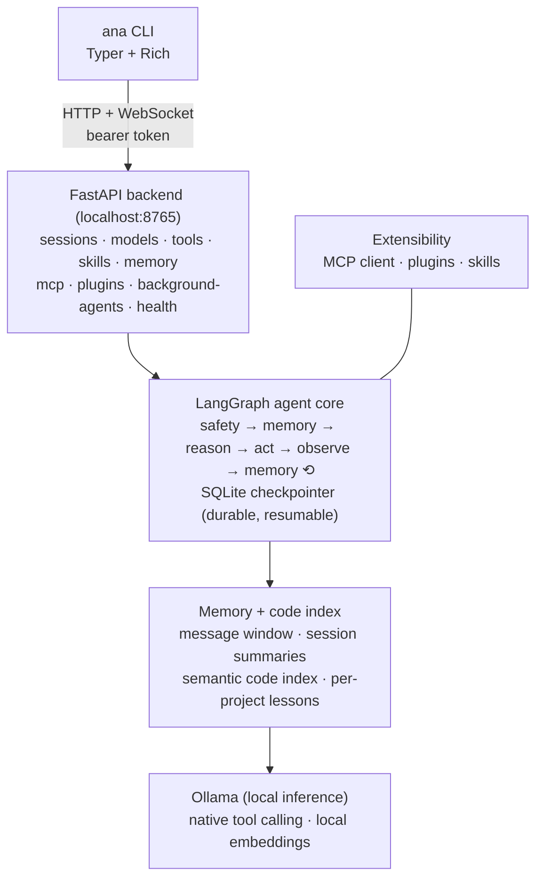

# Architecture

Ana is CLI-first: a Typer client talking to a local FastAPI backend that
runs a LangGraph agent over Ollama. Everything runs on your machine.

## Layered stack



## Agent graph topology

Each user turn runs through a fixed node sequence, looping between reason
and act until the model produces a final answer:

```
START
  → safety          Audit-logs the user's message; never ends the turn
  → pre_memory      Retrieves lessons, compacts if the next prompt is too
  │                 large, emits a context-budget event
  → reason          LLM call, streams tokens; native tool call or parsed
  │                 code block; classifies output as final answer vs.
  │                 pending action
  → [final answer   → finish_gate   Re-runs the impacted tests of the files
  │  after edits?]                  this turn edited. Sends the model back
  │                                 through post_memory a bounded number of
  │                                 times, else END
  → [no action?]    → END (final answer with no edits, interrupt, parse failure
  │                 after retries, iteration limit, or a repeating tool call)
  → code_act        Checks the permission-mode allowlist + permission
  │                 rules; pauses for confirmation on destructive tools
  │                 unless auto_accept; records a test baseline before the
  │                 first edit that needs one; runs post-edit verification
  → observe         Secrets redaction and injection flagging. Native calls get
  │                 one raw tool message per call; other models get one
  │                 content-isolation envelope as a user message
  → post_memory     Updates the budget, compacts past 75% of num_ctx
  → reason          Next iteration
```

There is no separate LLM critic/reflection node — quality control is the
deterministic [verification](../features/verification.md) check run inside
the act step after a file mutation, and the finish check at the end of the turn,
not an extra model call.

## Key design decisions

**Native tool-calling over prompt emulation.** Models whose profile has
`supports_native_tools: true` bind tools directly through the backend;
there is no system-prompt tool-emulation layer to maintain.

**Models see their own tool calls.** For a `native`-strategy model, history holds
the assistant's tool calls and one tool message per call, including calls that were
rejected, blocked, or dropped from a batch. Tool messages carry the raw output, and
the system prompt says tool results are untrusted. `constrained` and `prompted`
models keep a flat format, where a result is a wrapped user message. A call with no
tools bound, such as a retry after an unparseable tool call, gets the same history
rendered as text.

**A generation can't run away or pass as finished.** Each generation is capped by
`num_predict` (default 8192 tokens, about 700 lines of code; a preset's
`num_predict` overrides it; Ollama only). Output that hits the cap is never parsed
or treated as a final answer: the model is told it was cut off. The same tool call
with the same arguments three times in a turn gets a warning. A fourth doesn't run,
and the turn ends saying why. A read after an edit doesn't count as a repeat.

**Durable, resumable sessions.** By default every graph step checkpoints to
SQLite and waits for the write (`ANA_CHECKPOINT_DURABILITY=sync`), so a session
survives backend restarts and a crash mid-turn, and `/rewind` can go back to any
earlier user turn — see [Sessions & rewind](../usage/sessions.md).

**Single compaction path.** Context compaction is reached only through the
memory node (which also serves the user-initiated `/compact`), with a begin/end
guard against running two at once. The turn waits for it, so a prompt can't outgrow
the window meanwhile, and a rewind or interrupt cancels it. Earlier summaries are
kept as written, because a summary of a summary progressively degrades.

**Bearer-token localhost API.** The backend binds `127.0.0.1` and
generates a per-install token (`~/.ana/session.token`, `chmod 600`/ACL);
the CLI sends it on every HTTP and WebSocket request. See
[Security](security.md#bearer-token).

**Permission modes, not agent personalities.** One agent, one system
prompt, and a 3-level permission model (`plan`/`default`/`auto_accept`)
controlling how much it may touch — see
[Permission modes](../configuration/permissions.md).

**Two independent sub-agent mechanisms.** The in-context `task` tool
(read-only, context-isolating) and the daemon-driven background agents are
deliberately separate systems — see
[Subagents & background agents](../features/subagents.md).

**Pluggable sandbox.** Shell commands and lint and test checks go through a
sandbox factory preferring `sandbox-exec` on macOS, then Docker, then Bubblewrap
(Linux), falling back to local execution — see
[Security](security.md#sandbox).

## Where to go next

- [Permission modes](../configuration/permissions.md) — how tool access and
  confirmation work
- [Tools](../features/tools.md) — the full tool registry
- [Memory](../features/memory.md) — the message window, summaries, code index, lessons
- [Security](security.md) — project trust, sandboxing, secrets, path safety
- [Settings](../configuration/settings.md) — environment variables and
  config files
